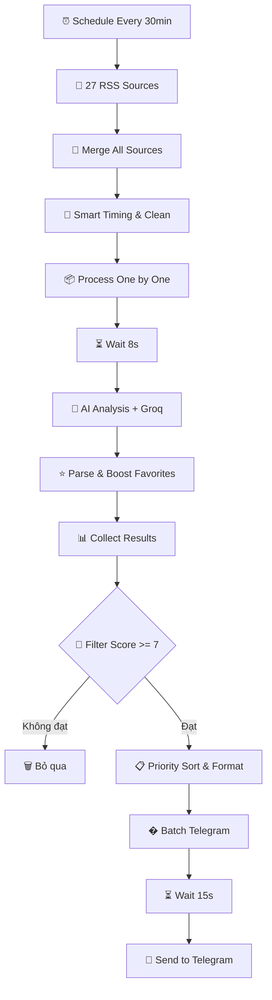
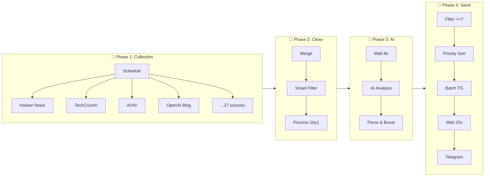

# 🤖 AI News Automation Agent (v9.0)

Chào mừng bạn đến với hệ thống tự động hóa tin tức AI toàn diện. Hệ thống này được thiết kế để hoạt động 24/7 trên nền tảng đám mây (Hugging Face / n8n), tự động **thu thập tin tức AI/Tech từ 27 nguồn**, **phân tích bằng AI (Groq/LLaMA)**, và **gửi tin quan trọng đến Telegram**.

---

## 🏗 Sơ Đồ Luồng Xử Lý



---

## 🔄 TỔNG QUAN WORKFLOW

Workflow này được chia thành **4 giai đoạn chính**:

| Phase | Mô tả | Nodes chính |
|-------|-------|-------------|
| **Phase 1** | Thu thập dữ liệu từ 27 nguồn RSS | Schedule Trigger → 27 RSS Nodes → Merge |
| **Phase 2** | Xử lý & lọc trùng | Smart Timing & Clean → Process One by One |
| **Phase 3** | Phân tích bằng AI | Wait 8s → AI Analysis (Groq) → Parse & Boost |
| **Phase 4** | Lọc chất lượng & gửi Telegram | Filter ≥7 → Priority Sort → Batch → Telegram |

---

## 📝 CHI TIẾT TỪNG NODE

### Phase 1: THU THẬP DỮ LIỆU (27 Sources)

| Node | Loại | Chức năng |
|------|------|-----------|
| **Schedule Every 30min** | Trigger | Khởi động workflow mỗi 30 phút |
| **Hacker News** | RSS Feed | Đọc RSS từ `hnrss.org/frontpage` |
| **TechCrunch AI** | RSS Feed | Tin AI từ TechCrunch |
| **ArXiv AI/ML/NLP/CV** | RSS Feed | Paper học thuật từ ArXiv |
| **OpenAI Blog** | RSS Feed | Blog chính thức từ OpenAI |
| **Google AI Blog** | RSS Feed | Blog từ Google AI |
| **DeepMind Blog** | RSS Feed | Blog từ DeepMind |
| **Anthropic Blog** | RSS Feed | Blog từ Anthropic |
| **Hugging Face** | RSS Feed | Tin từ Hugging Face |
| **MIT Tech Review** | RSS Feed | Tạp chí MIT Technology Review |
| **VentureBeat AI** | RSS Feed | Tin AI từ VentureBeat |
| **MarkTechPost** | RSS Feed | Tin AI từ MarkTechPost |
| **Towards Data Science** | RSS Feed | Bài viết từ Medium |
| **GitHub AI** | RSS Feed | Blog AI từ GitHub |
| **IEEE AI** | RSS Feed | Tin từ IEEE Spectrum |
| **Two Minute Papers** | YouTube RSS | Video review paper AI |
| **Yannic Kilcher** | YouTube RSS | Video phân tích paper |
| **AI Explained** | YouTube RSS | Video giải thích AI |
| **ML Street Talk** | YouTube RSS | Podcast AI |
| **The AI Epiphany** | YouTube RSS | Video AI |
| **Arxiv Insights** | YouTube RSS | Insights từ ArXiv |
| **Lex Fridman** | YouTube RSS | Podcast công nghệ |
| **Sentdex** | YouTube RSS | Tutorial ML/Python |
| **3Blue1Brown** | YouTube RSS | Video toán học |
| **Andrej Karpathy** | YouTube RSS | Video từ Karpathy |

---

### Phase 2: XỬ LÝ & LỌC TRÙNG

| Node | Chức năng |
|------|-----------|
| **Merge All Sources** | Gộp tất cả 27 nguồn RSS thành 1 stream |
| **Smart Timing & Clean** | • Lọc giờ: chỉ gửi từ 7AM-24:00 (giờ VN) <br> • Loại bỏ URL trùng lặp (lưu 5000 URL đã gửi) <br> • Giới hạn 5 items/batch <br> • Chuẩn hóa dữ liệu (title, description, URL) |
| **Process One by One** | Chia nhỏ thành từng item để xử lý tuần tự |

---

### Phase 3: PHÂN TÍCH AI

| Node | Chức năng |
|------|-----------|
| **Wait 8s (Free Tier Safe)** | Đợi 8 giây giữa các request (tránh rate limit Groq) |
| **AI Analysis** | Gửi prompt cho AI phân tích tin: <br> • Tóm tắt tiếng Việt (2-3 câu) <br> • Chấm điểm 1-10 <br> • Phân loại (LLM, ML_Research, Computer_Vision...) <br> • Sentiment, Impact, Key points |
| **Groq Model** | Sử dụng model **LLaMA 3.1 8B Instant** |
| **Parse & Boost Favorites** | • Parse JSON response từ AI <br> • **Boost +2 điểm** cho category yêu thích (LLM, AI_Coding, AI_Tools) |

---

### Phase 4: LỌC & GỬI TELEGRAM

| Node | Chức năng |
|------|-----------|
| **Collect Results** | Gom kết quả từ vòng lặp |
| **Filter Score >= 7** | Chỉ giữ tin có điểm ≥ 7/10 |
| **Priority Sort & Format** | • Sắp xếp theo điểm (cao nhất trước) <br> • Giới hạn 5 tin <br> • Format message HTML cho Telegram |
| **Batch Telegram** | Chia thành từng tin để gửi |
| **Wait 15s (Strict)** | Đợi 15 giây giữa các tin (tránh spam) |
| **Send to Telegram** | Gửi tin đến chat ID của bạn |

---

## 🔗 LUỒNG DỮ LIỆU CHI TIẾT



---

## 📱 OUTPUT MẪU GỬI ĐẾN TELEGRAM

```
TIÊU ĐỀ: GOOGLE RELEASES NEW GEMINI 2.0 MODEL

Điểm: 9/10 | Category: LLM
Khuyến nghị: must_read
Sắc thái: Tích cực | Tầm quan trọng: Cao

Tóm tắt:
Google vừa ra mắt Gemini 2.0 với khả năng xử lý đa phương thức tốt hơn...

Điểm nổi bật:
  • Tốc độ xử lý tăng 50%
  • Hỗ trợ context window lớn hơn

Link bài viết: https://blog.google/...

Thời gian: 29/01/2026, 20:05:30
```

---

## ⚙️ TÍNH NĂNG THÔNG MINH

| Tính năng | Mô tả |
|-----------|-------|
| **🌙 Lọc giờ** | Chỉ gửi từ 7:00 - 24:00 (giờ VN), đêm thì queue lại |
| **🔄 Chống trùng** | Lưu 5000 URL đã gửi, không gửi lại |
| **⏱️ Rate limiting** | Wait 8s (Groq) + Wait 15s (Telegram) để tránh bị block |
| **📊 Priority Queue** | Tin điểm cao nhất gửi trước |
| **⭐ Favorite Boost** | Category yêu thích được +2 điểm |

---

## 🛠 HƯỚNG DẪN CÀI ĐẶT

### Prerequisites
- n8n (self-hosted hoặc cloud)  
- Groq API key (miễn phí tại [console.groq.com](https://console.groq.com))
- Telegram Bot Token (tạo từ [@BotFather](https://t.me/BotFather))

### File Workflow
| File | Mô tả |
|------|-------|
| `My workflow 9.json` | Bản gốc, dùng cho chạy Local (có lưu CSV) |
| `My workflow 9_cloud.json` | **Khuyên dùng** - Bản tối ưu cho Cloud |

### Cách Import
1. Download file `My workflow 9_cloud.json`
2. Trong n8n, vào **Settings** → **Import from file**
3. Chọn file JSON
4. Vào **Credentials** → Kết nối lại:
   - **Groq API** (nhập API key)
   - **Telegram API** (nhập Bot Token + Chat ID)
5. Bật nút **Active** (góc phải trên cùng)

### Tùy Chỉnh
Nếu muốn thay đổi ngưỡng lọc tin (ví dụ chỉ nhận tin cực hot 9/10):
- Mở node **Filter Score >= 7**
- Sửa số `7` thành `9`

---

## � CẤU TRÚC PROJECT

```
n8n/
├── My workflow 9.json          # Workflow gốc (local)
├── My workflow 9_cloud.json    # Workflow cho cloud (khuyên dùng)
├── README.md                   # Tài liệu chính (file này)
├── WORKFLOW_ARCHITECTURE.md    # Kiến trúc workflow
├── WORKFLOW_EXPLANATION.md     # Giải thích chi tiết
├── QUICK-START.md              # Hướng dẫn nhanh
├── TROUBLESHOOTING.md          # Xử lý lỗi
├── ai-news-agent-guide.md      # Hướng dẫn sử dụng
└── docs/
    └── workflow-screenshot.png # Screenshot workflow
```

---

## 📄 License

MIT License - Tự do sử dụng và tùy chỉnh theo nhu cầu.

---

*Được tạo bởi BuccKyy với sự hỗ trợ từ AI Assistant • Cập nhật: 29/01/2026*
