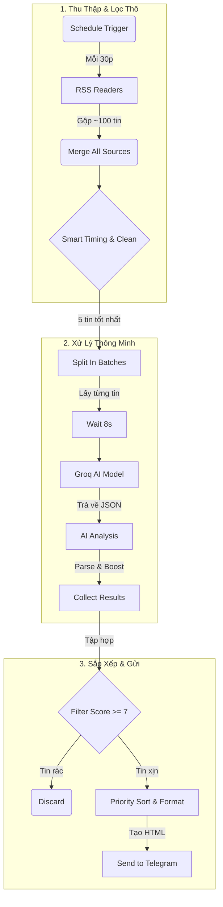

# 🏛 CẤU TRÚC HOẠT ĐỘNG CHI TIẾT (WORKFLOW ARCHITECTURE)

Tài liệu này giải thích sâu về **logic kỹ thuật** và **luồng dữ liệu** bên trong workflow. Dành cho bạn nếu muốn hiểu rõ "tại sao nó chạy được như vậy".

---

## 1. Sơ Đồ Luồng Dữ Liệu (Data Flow Diagram)

Hệ thống hoạt động theo mô hình **ETL (Extract - Transform - Load)**:

---

## 2. Giải Mã Các Node Quan Trọng

### 🟢 Giai đoạn 1: Thu Thập & Làm Sạch

#### Node `Smart Timing & Clean` (Javascript)
Đây là "người gác cổng" của hệ thống. Nó thực hiện 3 nhiệm vụ logic phức tạp:
1.  **Time Gating (Chặn giờ)**: 
    - Kiểm tra giờ hiện tại (Timezone VN).
    - Nếu < 7:00 sáng: **Không xử lý ngay**, mà lưu toàn bộ tin vào "Hàng đợi đêm" (QueuedItems).
    - Nếu >= 7:00 sáng: Xả hàng đợi đêm + Xử lý tin mới.
2.  **Deduplication (Chống trùng)**:
    - Lưu danh sách URL đã gửi (`sentUrls`) vào bộ nhớ vĩnh viễn của n8n (Static Data).
    - So sánh tin mới với danh sách này. Nếu trùng -> Loại bỏ ngay lập tức.
    - Bộ nhớ này tự động xoay vòng (chỉ nhớ 5000 link gần nhất) để không bị đầy.
3.  **Safety Limit (Giới hạn an toàn)**:
    - Bất kể có bao nhiêu tin mới, nó chỉ cho phép **tối đa 5 tin** đi qua trong mỗi lần chạy (30 phút).
    - Mục đích: Tránh làm nổ API của Groq và tránh spam Telegram của bạn.

---

### 🟡 Giai đoạn 2: Phân Tích AI

#### Node `Groq Model` & `AI Analysis`
Sử dụng mô hình ngôn ngữ lớn (LLM) để "đọc hiểu" bài báo.
- **Prompt kỹ thuật**:
  - Yêu cầu AI đóng vai chuyên gia công nghệ.
  - Input: Title, Description, URL.
  - Output bắt buộc: **JSON Format** (để máy tính đọc được, không phải văn bản thường).
  - Các trường cần trích xuất: `summary` (tóm tắt), `score` (điểm số), `category` (phân loại), `sentiment` (cảm xúc).

#### Node `Parse & Boost Favorites` (Javascript)
Sau khi AI trả lời, node này sẽ:
1.  Đọc chuỗi JSON từ AI.
2.  **Cộng điểm ưu tiên**: Nếu bài viết thuộc chủ đề bạn thích (ví dụ "LLM", "AI_Encoding"), nó tự động **+2 điểm** vào Score. Điều này giúp các tin đúng gu của bạn dễ dàng lọt qua bộ lọc hơn.

---

### 🔴 Giai đoạn 3: Phân Phối

#### Node `Filter Score >= 7`
Đây là bộ lọc chất lượng cuối cùng.
- Logic: `nếu (score >= 7) thì GIỮ LẠI, ngược lại VỨT BỎ`.
- Đảm bảo bạn chỉ nhận thông báo về những tin tức thực sự giá trị.

#### Node `Priority Sort & Format` (Javascript)
Trước khi gửi đi, node này làm đẹp dữ liệu:
1.  **Sắp xếp**: Đưa tin nào điểm cao nhất lên đầu danh sách.
2.  **HTML Templating**: Tạo ra một đoạn tin nhắn Telegram với định dạng HTML (In đậm tiêu đề, tạo hyperlink, chèn biểu tượng).
3.  **Keyboard**: Tạo các nút bấm tương tác (Đọc ngay, Lưu lại) dưới mỗi tin nhắn.

#### Node `Send to Telegram`
- Sử dụng API Telegram Bot.
- Gửi tin nhắn đã được định dạng ở trên tới Chat ID của bạn.

---

## 3. Cơ Chế Lưu Trữ

- **Cloud Version**: Không sử dụng ổ cứng (vì Cloud sẽ xóa dữ liệu khi restart). Thay vào đó, nó dựa hoàn toàn vào **n8n Static Data** (Bộ nhớ đệm trong database của n8n) để nhớ các link đã gửi.
- **Local Version**: Có sử dụng node `Write Binary File` để lưu file CSV vào máy tính cá nhân (làm kho lưu trữ lịch sử).

Tài liệu này giúp bạn hiểu rõ "nội tạng" của con bot này. Nếu muốn sửa logic, hãy tập trung vào các node Javascript (màu cam)!
