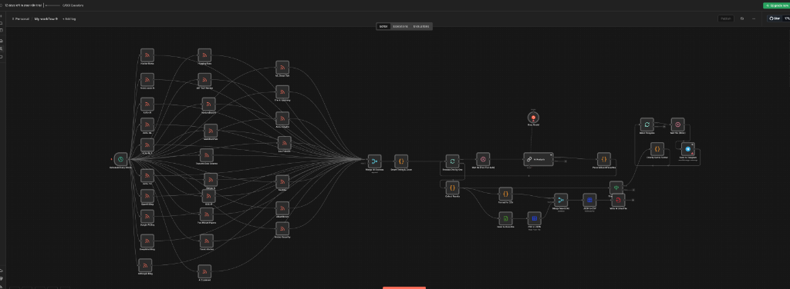

# 🤖 AI News Aggregator - Giải Thích Chi Tiết Workflow

> **Tài liệu này giải thích toàn bộ cách hoạt động của workflow n8n AI News Aggregator**

---

## 🔄 TỔNG QUAN WORKFLOW

Workflow này tự động **thu thập tin tức AI/Tech từ 27 nguồn**, **phân tích bằng AI (Groq/LLaMA)**, và **gửi tin quan trọng đến Telegram**.



---

## 📊 SƠ ĐỒ CÁC NODE VÀ KẾT NỐI

```
┌─────────────────────────────────────────────────────────────────────────────────────┐
│  PHASE 1: THU THẬP DỮ LIỆU (27 RSS Sources)                                        │
├─────────────────────────────────────────────────────────────────────────────────────┤
│                                                                                      │
│  ⏰ Schedule Every 30min ────┬──► Hacker News ─────────┐                            │
│                              ├──► TechCrunch AI ───────┤                            │
│                              ├──► ArXiv AI ────────────┤                            │
│                              ├──► ArXiv ML ────────────┤                            │
│                              ├──► ArXiv NLP ───────────┤                            │
│                              ├──► ArXiv CV ────────────┤                            │
│                              ├──► OpenAI Blog ─────────┤                            │
│                              ├──► Google AI Blog ──────┤                            │
│                              ├──► DeepMind Blog ───────┤                            │
│                              ├──► Anthropic Blog ──────┼──► Merge All Sources       │
│                              ├──► Hugging Face ────────┤                            │
│                              ├──► MIT Tech Review ─────┤                            │
│                              ├──► VentureBeat AI ──────┤                            │
│                              ├──► MarkTechPost ────────┤                            │
│                              ├──► Towards Data Science ┤                            │
│                              ├──► GitHub AI ───────────┤                            │
│                              ├──► IEEE AI ─────────────┤                            │
│                              ├──► Two Minute Papers ───┤ (YouTube)                  │
│                              ├──► Yannic Kilcher ──────┤ (YouTube)                  │
│                              ├──► AI Explained ────────┤ (YouTube)                  │
│                              ├──► ML Street Talk ──────┤ (YouTube)                  │
│                              ├──► The AI Epiphany ─────┤ (YouTube)                  │
│                              ├──► Arxiv Insights ──────┤ (YouTube)                  │
│                              ├──► Lex Fridman ─────────┤ (YouTube)                  │
│                              ├──► Sentdex ─────────────┤ (YouTube)                  │
│                              ├──► 3Blue1Brown ─────────┤ (YouTube)                  │
│                              └──► Andrej Karpathy ─────┘ (YouTube)                  │
│                                                                                      │
├─────────────────────────────────────────────────────────────────────────────────────┤
│  PHASE 2: XỬ LÝ & LỌC TRÙNG                                                         │
├─────────────────────────────────────────────────────────────────────────────────────┤
│                                                                                      │
│  Merge All Sources ──► Smart Timing & Clean ──► Process One by One                 │
│                        (Lọc trùng, giới hạn      (Xử lý từng item)                  │
│                         5 items, lọc giờ)                                           │
│                                                                                      │
├─────────────────────────────────────────────────────────────────────────────────────┤
│  PHASE 3: PHÂN TÍCH AI                                                              │
├─────────────────────────────────────────────────────────────────────────────────────┤
│                                                                                      │
│  Process One by One ──► Wait 8s ──► AI Analysis ──► Parse & Boost Favorites        │
│                                      │              (Boost điểm cho                 │
│                                      │               category yêu thích)            │
│                                      ├─ Groq Model                                  │
│                                         (LLaMA 3.1 8B)                              │
│                                                                                      │
├─────────────────────────────────────────────────────────────────────────────────────┤
│  PHASE 4: LỌC CHẤT LƯỢNG & GỬI                                                      │
├─────────────────────────────────────────────────────────────────────────────────────┤
│                                                                                      │
│  Parse & Boost ──► Collect Results ──► Filter Score >= 7 ──┬─► Priority Sort        │
│                                                             │   & Format            │
│                                                             │        │              │
│                                                             │        ▼              │
│                                                             │   Batch Telegram      │
│                                                             │        │              │
│                                                             │        ▼              │
│                                                             │   Wait 15s (Strict)   │
│                                                             │        │              │
│                                                             │        ▼              │
│                                                             └── Send to Telegram    │
│                                                                                      │
└─────────────────────────────────────────────────────────────────────────────────────┘
```

---

## 📝 CHI TIẾT TỪNG NODE

### 1. PHASE 1: THU THẬP DỮ LIỆU

| Node | Loại | Chức năng |
|------|------|-----------|
| **Schedule Every 30min** | Trigger | Khởi động workflow mỗi 30 phút |
| **Hacker News** | RSS Feed | Đọc RSS từ `hnrss.org/frontpage` |
| **TechCrunch AI** | RSS Feed | Tin AI từ TechCrunch |
| **ArXiv AI/ML/NLP/CV** | RSS Feed | Paper học thuật từ ArXiv |
| **OpenAI/Google/DeepMind/Anthropic Blog** | RSS Feed | Blog từ các công ty AI lớn |
| **Hugging Face** | RSS Feed | Tin từ Hugging Face |
| **Two Minute Papers, Yannic Kilcher, etc.** | RSS Feed | Video AI mới từ YouTube |

---

### 2. PHASE 2: XỬ LÝ & LỌC TRÙNG

| Node | Chức năng |
|------|-----------|
| **Merge All Sources** | Gộp tất cả 27 nguồn RSS thành 1 stream |
| **Smart Timing & Clean** | - Lọc giờ (chỉ gửi từ 7AM-12PM theo múi giờ VN)<br>- Loại bỏ URL trùng lặp (lưu 5000 URL đã gửi)<br>- Giới hạn 5 items/batch<br>- Chuẩn hóa dữ liệu (title, description, URL) |
| **Process One by One** | Chia nhỏ thành từng item để xử lý tuần tự |

---

### 3. PHASE 3: PHÂN TÍCH AI

| Node | Chức năng |
|------|-----------|
| **Wait 8s (Free Tier Safe)** | Đợi 8 giây giữa các request (tránh rate limit Groq) |
| **AI Analysis** | Gửi prompt cho AI phân tích tin:<br>- Tóm tắt tiếng Việt<br>- Chấm điểm 1-10<br>- Phân loại (LLM, ML_Research, Computer_Vision...)<br>- Sentiment, Impact, Key points |
| **Groq Model** | Sử dụng model **LLaMA 3.1 8B Instant** |
| **Parse & Boost Favorites** | - Parse JSON response từ AI<br>- **Boost +2 điểm** cho category yêu thích (LLM, AI_Coding, AI_Tools) |

---

### 4. PHASE 4: LỌC & GỬI TELEGRAM

| Node | Chức năng |
|------|-----------|
| **Collect Results** | Gom kết quả từ vòng lặp |
| **Filter Score >= 7** | Chỉ giữ tin có điểm ≥ 7/10 |
| **Priority Sort & Format** | - Sắp xếp theo điểm (cao nhất trước)<br>- Giới hạn 5 tin<br>- Format message HTML cho Telegram |
| **Batch Telegram** | Chia thành từng tin để gửi |
| **Wait 15s (Strict)** | Đợi 15 giây giữa các tin (tránh spam) |
| **Send to Telegram** | Gửi tin đến chat ID của bạn |

---

## 🔗 LUỒNG DỮ LIỆU CHI TIẾT

```
Schedule ─(parallel)─► 27 RSS Sources ─(all)─► Merge ─► Clean/Dedupe ─► Split
                                                                          │
    ┌─────────────────────────────────────────────────────────────────────┘
    │
    ▼
┌─────────┐     ┌────────────┐     ┌──────────────────────┐
│ Wait 8s │ ──► │ AI Analysis│ ──► │ Parse & Boost        │
└─────────┘     │   + Groq   │     │ (score + category)   │
                └────────────┘     └──────────┬───────────┘
                                              │
                                              ▼
                                        ┌───────────┐
                                        │ Collect   │
                                        │ Results   │
                                        └─────┬─────┘
                                              │
                                              ▼
                                        ┌───────────────┐
                                        │ Filter ≥ 7    │ ──(không đạt)──► Bỏ qua
                                        └───────┬───────┘
                                                │ (đạt)
                                                ▼
                                        ┌───────────────┐     ┌──────────┐
                                        │ Priority Sort │ ──► │ Batch TG │
                                        │ & Format      │     └────┬─────┘
                                        └───────────────┘          │
                                                                   ▼
                                                             ┌──────────┐
                                                             │ Wait 15s │
                                                             └────┬─────┘
                                                                  │
                                                                  ▼
                                                            ┌──────────────┐
                                                            │ Send Telegram│
                                                            └──────────────┘
```

---

## 📱 OUTPUT MẪU GỬI ĐẾN TELEGRAM

```html
<b>TIÊU ĐỀ: GOOGLE RELEASES NEW GEMINI 2.0 MODEL</b>

Điểm: 9/10 | Category: LLM
Khuyến nghị: must_read
Sắc thái: Tích cực | Tầm quan trọng: Cao

Tóm tắt:
Google vừa ra mắt Gemini 2.0 với khả năng xử lý đa phương thức tốt hơn...

Điểm nổi bật:
  • Tốc độ xử lý tăng 50%
  • Hỗ trợ context window lớn hơn

Link bài viết: https://blog.google/...

Thời gian: 29/01/2026, 20:05:30
```

---

## ⚙️ TÍNH NĂNG THÔNG MINH

| Tính năng | Mô tả |
|-----------|-------|
| **Lọc giờ** | Chỉ gửi từ 7:00 - 24:00 (giờ VN), đêm thì queue lại |
| **Chống trùng** | Lưu 5000 URL đã gửi, không gửi lại |
| **Rate limiting** | Wait 8s (Groq) + Wait 15s (Telegram) để tránh bị block |
| **Priority Queue** | Tin điểm cao nhất gửi trước |
| **Favorite Boost** | Category yêu thích được +2 điểm |

---

## 🛠️ CÀI ĐẶT

### Prerequisites
- n8n (self-hosted hoặc cloud)
- Groq API key
- Telegram Bot Token

### Cách import
1. Download file `workflow.cloud.json`
2. Trong n8n, vào **Settings > Import from file**
3. Chọn file JSON
4. Cấu hình credentials (Groq, Telegram)

---

## 📁 CẤU TRÚC PROJECT

```
n8n/
├── workflow.json          # Workflow gốc (local)
├── workflow.cloud.json    # Workflow cho cloud
├── README.md                   # Tài liệu chính
├── WORKFLOW_EXPLANATION.md     # Giải thích chi tiết (file này)
├── WORKFLOW_ARCHITECTURE.md    # Kiến trúc workflow
├── QUICK-START.md              # Hướng dẫn nhanh
├── TROUBLESHOOTING.md          # Xử lý lỗi
└── ai-news-agent-guide.md      # Hướng dẫn sử dụng
```

---

## 📄 License

MIT License - Tự do sử dụng và tùy chỉnh theo nhu cầu.

---

*Được tạo bởi BuccKyy với sự hỗ trợ từ AI Assistant*
